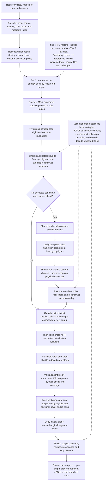

# VideoRebuild

VideoRebuild reconstructs supported AVC/HEVC MP4 video from recovered files and optional original disk-image evidence. It runs locally with Python 3.13+ and no third-party Python runtime dependencies. FFmpeg and ffprobe 8+ are required for codec validation; reconstruction-only mode does not require them.

Version 0.3.0 uses one case and byte-range model for ordinary and fragmented MP4. Logical file bytes may come from multiple noncontiguous image extents. Original inputs remain read-only; output belongs on healthy storage outside every input tree.

A successful decode does not prove original recording identity or completeness. Reports distinguish acquisition status, association evidence and media validation. Missing bytes remain missing; later recoverable sections are separate clips.

## Install

From this checkout, install with pip in a virtual environment:

```bash
python3.13 -m venv .venv
source .venv/bin/activate
python -m pip install .
videorebuild tui
```

Installation creates the `videorebuild` command. All recovery, reporting and TUI
commands use that same entry point:

```bash
videorebuild --help
videorebuild run --input /recovery/files --case /healthy/case --reconstruct-only
videorebuild tui --case /healthy/case --watch
```

For an isolated command available from any directory, use either
[pipx](https://packaging.python.org/en/latest/guides/installing-stand-alone-command-line-tools/)
or [uv](https://docs.astral.sh/uv/guides/tools/#installing-tools):

```bash
pipx install --python python3.13 .
# Or:
uv tool install --python 3.13 .
```

For development, use `python -m pip install -e .` in the activated project
virtual environment. Regular and editable installs follow the
[standard pip local-project workflow](https://pip.pypa.io/en/stable/topics/local-project-installs/).
Python packages are installed into the selected environment; FFmpeg/ffprobe
remain separately installed system tools when codec validation is enabled.

## How recovery works

VideoRebuild matches available encoded bytes to surviving container metadata. It does not choose a first clip by filename, compare scenes, or infer an unknown timeline. Ordinary MP4 uses sample tables as its layout and ordering template; fragmented MP4 uses adjacent fragment boxes, sequence numbers and per-track media timing. The workflow runs the ordinary strategy, including any deferred deep search, before the fragmented strategy.


The graphic summarizes the two models side by side. The Mermaid flow below makes the execution order and the deep-search condition explicit. Range checks apply to every strategy and actual source read; the original index may include bytes excluded by a later allocation policy.



### How initial candidates are chosen

| Strategy | Candidate selection | What determines sequence |
| --- | --- | --- |
| Ordinary: original offsets | For each eligible location of the exact `moov`, try file/logical-source origin zero and the nearest preceding permitted `ftyp` origin. Add that origin to the metadata's chunk offsets. | The surviving sample tables specify chunk/sample order, track configuration and timing. |
| Ordinary: whole payload | Try indexed `mdat` payloads in completed sources large enough for the whole metadata chunk span. Align the first referenced chunk with the payload start and apply one translation to all chunk offsets. Default search has no candidate-count or trailing-padding cutoff. | Original relative chunk offsets remain fixed in each hypothesis; bytes are not chosen by file date, name or visual similarity. |
| Ordinary: deep search | Only when `--deep` is enabled and whole-payload search found no accepted candidate: use selected video sample sizes and 4-byte NAL-length chains to nominate extent starts, then check all video sample framing in each extent. | An extent is one video chunk plus adjacent audio chunks, with internal relative offsets preserved. Compatible extent locations may be scattered or physically out of order; output order comes from the metadata. |
| Fragmented MP4 | Use verified PhotoRec initialization anchors when present for a source, otherwise indexed `ftyp` locations. Require a supported `ftyp` + `moov` initialization with `mvex`/`trex`. First try its end, then indexed `moof` starts before the next initialization or source end. | Each `moof` must be immediately followed by its supported `mdat`. Sequences increment by one and explicit track decode times must agree with accumulated durations. |

An anchor hit is a search lead, not an identity proof. Deep search keeps matching physical locations, including equal-content alternatives, until it can establish a joint non-overlapping assignment. It considers selective groups first to reduce branching, then restores metadata order. If any required group is missing, ordinary reconstruction cannot invent it. Deep search does not infer arbitrary sector permutations inside a group, and does not search scattered alternatives after a whole-payload candidate has already survived.

A fragmented prefix must begin with sequence 0 or 1 and an IDR for every video track. A prefix may omit initial `tfdt` timing and accumulate media time from zero; any supplied explicit timing must agree with accumulated durations. A later independent section may start at another sequence, but needs an IDR for every video track and an explicit first decode time for every declared track. Every declared track must appear before publication. Missing restart timing, unavailable ranges or sequence discontinuities stop or block a section; later eligible starts are considered separately. Media timestamps do not establish wall-clock dates.

### How bytes become an output

Ordinary reconstruction checks complete chunk assignments, source identity, permitted/readable ranges, full video sample framing and logical/physical non-overlap. It copies the original encoded chunks, writes a new generic `ftyp` and `mdat`, and rewrites `moov` chunk offsets as `co64`. It does not re-encode the samples. Fragmented reconstruction copies the original initialization and surviving section bytes; it does not rewrite fragment headers to conceal gaps.

Both strategies record output hashes and source provenance. Default mode also applies codec validation; `--reconstruct-only` skips FFmpeg/ffprobe and labels outputs with `decode_checked=false`. In ordinary recovery, multiple byte-distinct accepted results remain `ambiguous`; a cutoff remains `search_limited`, and no accepted candidate remains `unresolved`. Only a unique accepted result within the completed ordinary search model receives an authoritative publication. Fragmented publications retain prefix/segment scope rather than claiming a complete historical recording.

### Recovered fragments and the two search tiers

**Recovered references move to a second matching tier; source files and indexed evidence are not deleted.** Tier 1 prioritizes physical ranges not already used by accepted recovered outputs. Tier 2 retains those used ranges as fallback evidence. The default searches Tier 1 only. Use `--include-recovered` to check the lower-priority tier when Tier 1 finds no match for the target:

```bash
videorebuild recover --case /healthy/case --deep --retry --include-recovered
```

This is a search heuristic: a Tier 1 success does not trigger a Tier 2 uniqueness audit. Reports record `search_tiers`, including which tiers were searched and whether the second tier remained unsearched; CSV/HTML expose that scope too. A first-tier miss does not prove absence in the second tier. Successful published outputs supply the physical references for demotion; content equality alone does not prove that two separately stored locations are the same physical bytes. Completed jobs can still be skipped on resume after checking their publications.

Within one ordinary assembly, overlapping physical ranges cannot be reused, including the same bytes exposed through different input mappings. Within one fragmented initialization job, a local `consumed` boundary skips starts already covered by an accepted/published section. Failed section attempts do not advance that boundary. Neither rule establishes global ownership across all outputs.

This is not an assumption that original FAT files share clusters through hard links or symlinks. Normal FAT file allocation gives a file its cluster chain. The uncertainty is which surviving metadata actually belongs to which payload: sample sizes, NAL framing, codec settings and even successful decoding can be compatible without proving historical association. Recovered copies and raw-image views can also expose evidence from the same original bytes through separate inputs. Tiering deliberately makes earlier accepted associations higher priority; enabling fallback preserves a route to competing associations when no first-tier match is found.

**Current limitation:** recovery does not globally reconcile overlapping source-range claims across different recovered recordings. Such outputs are competing associations to review, not automatically independent recordings. Trustworthy filesystem extent/ownership evidence can strengthen association; unallocated-range eligibility, structural success and archive novelty alone do not prove it.

Each recovered file's accompanying JSON includes an `ordered_fragments` manifest. Entries identify assembly order, source locations, physical extents where available, destination offsets, lengths and hashes. Initialization, padding/container spans and generated ordinary-container bytes are labelled separately; a fragmented media entry covers its complete `moof`/`mdat` pair and records sequence, track sample counts and decode-time metadata. The manifest describes the actual copied/generated assembly, not inferred wall-clock recording order. Existing publications are backfilled on resume where saved provenance supports it; insufficient historical evidence is explicitly flagged rather than invented.

### Failure points, risks and performance costs

| Stage | Failure or interpretation risk | Main cost / mitigation |
| --- | --- | --- |
| Metadata and source intake | Missing/split `moov`, unsupported tracks, unavailable bytes or an incorrect supplied allocation map can prevent or mis-scope recovery. No metadata or frames are fabricated. | Initial bounded scan and hashing; completed indexes are reused. Allocation policy gates reconstruction reads without rebuilding the index. |
| Whole-payload matching | Layout compatibility is not historical recording identity. Unsupported layouts or overwritten bytes may never match. | Many metadata jobs × many eligible `mdat` translations; canonical mapping hashes and durable attempt-cache lookups/writes. Prepared offset plans reduce repeated work. Completed case reads avoid pinning SQLite WAL growth. |
| Deep discovery | Size/NAL anchors can collide; required contiguous groups may be missing. Audio association follows the metadata/group model; reconstruction-only mode does not decode-check it. | Scanning permitted bytes, NAL-chain checks, candidate framing and hashing. Shared discovery avoids a separate source scan for every metadata batch. |
| Assembly | Multiple feasible byte-distinct mappings remain ambiguous. Per-output non-overlap does not settle cross-output ownership. | Content combinations and physical-witness backtracking can grow rapidly. Selective group ordering and overlap pruning reduce work without discarding feasible alternatives. |
| Fragmented sections | Unsupported addressing, missing IDR/timing, absent tracks, sequence gaps or byte-window bounds stop or block a section. A recovered prefix ending does not prove the original recording ended there. | Repeated bounded parsing and sample checks at eligible starts. Cheap restart prefilters and completed-job reuse avoid unnecessary full reads. |
| Output and validation | Disk exhaustion, changed sources/publications or explicit budgets can stop recovery. Structural success alone does not establish playability, chronology or camera identity. | Payload reads/copies, hashes, flush/fsync, and strict-mode probing/decoding. Temporary SQLite stores bound RAM, but search/evidence/output disk use still grows; there is no total-case retention quota. |

See [ordinary support and grouping limits](docs/SUPPORT.md), [fragmented sequence/timing rules](docs/FRAGMENTED.md) and [shared source/range architecture](docs/ARCHITECTURE.md). Implementation entry points are [`whole_payload`, `deep_search`, `attempt`, `reconstruct` and `finish`](src/videorebuild/engine.py), [`recover_fragmented`](src/videorebuild/image_recovery.py) and [`walk_prefix`](src/videorebuild/fragmented.py). The [graphic generation brief](docs/images/recovery-process-prompt.md) records how the explanatory image was produced; code and the detailed contracts remain authoritative.

## Run

Check tools, then recover supplied files:

```bash
videorebuild doctor
videorebuild run --input /recovery/files --case /healthy/case
```

For PhotoRec headers and the original raw image:

```bash
videorebuild run \
  --input /recovery/photorec \
  --image /images/disk.img \
  --report /recovery/photorec/recup_dir.1/report.xml \
  --mapfile /images/disk.map \
  --case /healthy/case
```

The PhotoRec report is optional. When supplied, small recovered MP4 headers must match their reported image bytes exactly. Image size must match reported geometry. Initialization locations remain separate jobs even if codec headers are identical. Image indexing is a sequential bounded scan, not a full-image allocation in memory.

For filesystem-guided reconstruction, produce a DFXML report with the installed Sleuth Kit (qualified locally with fiwalk 4.14.0), then import its raw byte runs:

```bash
fiwalk -x -z -g -G0 /images/disk.img > /healthy/filesystem.xml
videorebuild run \
  --image /images/disk.img --extents /healthy/filesystem.xml \
  --mapfile /images/disk.map --case /healthy/case
```

Fiwalk is optional external tooling, not a Python dependency. Its exit code alone does not establish successful mapping: VideoRebuild validates the complete XML and each object's extent map. This path searches the mapped logical files; it does not separately scan the entire image for unlisted objects. Filesystem support depends on the metadata and external tool; no proprietary filesystem support is claimed.

A mapfile qualifies only mapped image bytes. `+` means reported rescued; other map states and uncovered regions are unavailable. Without a mapfile acquisition status is unknown. If acquisition used different input/output positions, supply `--map-offset DELTA`, where image position = mapfile position + DELTA. Never infer this transform from filenames or file contents.

## Terminal interface

Open the keyboard-driven interface, inspired by PhotoRec and TestDisk:

```bash
videorebuild tui
videorebuild tui --case /healthy/case
videorebuild tui --case /healthy/case --watch
```

After an editable install, the same `videorebuild tui` command runs the working source.
The interface uses Python's standard-library `curses` module on macOS and Linux;
it needs an interactive terminal and adds no Python dependencies.

Use the arrow keys and Enter to select actions and change options. Path fields
open a filesystem browser in the style of PhotoRec:

- **Up/Down** moves through entries; **Enter/Right** opens a directory.
- **Left/Backspace**, or opening `..`, goes to the parent directory.
- **C** selects the current directory for a case or recovered-input folder.
- **Enter** selects a file for recovered input, a raw image, or an allocation map.
- **N** names a new case folder inside the current directory. Browsing only
  records that path; the recovery command creates it when started.
- **G** jumps to a typed path; **D** clears an optional field; **Q/Esc** cancels.

Directories appear before files, and the list scrolls with the selection.
Mounted macOS drives are accessible under `/Volumes`. Browsing reads directory
entries and creates no files or directories.

Choose an existing case to resume recovery, or supply a recovered-files root
and/or a regular raw image for indexing. Scan-only and scan-plus-recovery are
separate actions. Review the generated command before starting it. The menu
starts with deep search enabled, codec checks disabled (`--reconstruct-only`),
and second-tier fallback disabled. These menu defaults are shown explicitly;
the existing CLI defaults are unchanged. Advanced mapping and search-budget
options remain available through the CLI.

Starting an operation returns the terminal to the canonical CLI for live phase
and work counters, then returns to the menu when it finishes. The existing case
lock prevents a second writer, and progress appends to the same case `run.log`.
During a foreground operation, Ctrl-C uses the CLI's normal interruption/resume
handling.

The **watch** screen reads recent log lines, indexed-source and job counts,
case-lock state, and available output space without opening the case for
recovery. It refreshes automatically; quitting the viewer leaves any running
recovery untouched. A free lock or quiet log does not prove successful
completion. Check the owning process's exit status and final reports.
An idle-case snapshot briefly holds a shared lock while reading counts. If a
simultaneous CLI launch reports that the case is busy, retry the launch.

An allocation-map path applies only to **recover existing index**. The menu
rejects it for scan actions rather than ignoring the restriction. Raw-image
indexing without filesystem extents includes allocated bytes; the interface
does not infer unallocated space or PhotoRec Free-mode provenance.

## Progress and recovery scope

Commands and diagnostic tools report operation phases on stderr, including actual work counters, elapsed time, and throttled updates. Byte operations show throughput and an estimated remaining time when their total is known. Decoder waits report elapsed activity without an invented percentage. Finished, failed, and interrupted phases are distinct; finishing a phase does not mean every recording was recovered or historically identified. Progress is also recorded in a case’s `run.log`.

Use `--no-progress` to suppress progress feedback; warnings and errors remain visible. The option works before or after a CLI subcommand and on the diagnostic/build tools. Stdout result formats and JSON report schemas are unchanged. Progress uses newline records even when redirected, with no terminal escape animation.

For a PhotoRec run explicitly made in **Free / unallocated-space-only** mode, process its exported files as the working set:

```bash
videorebuild run --input /recovery/photorec-free --case /healthy/free-space-case
```

This invocation does not scan an image and has no automatic image-scan fallback. The free-space provenance comes from the PhotoRec run’s selection, not from VideoRebuild inferring allocation from filenames. For an already indexed image case, constrain reconstruction with an independently established allocation map as described below; the existing index need not be rebuilt.

Supplying `--image` without `--extents` indexes available bytes across the image, including allocated space. A PhotoRec `--report` verifies header locations but does not restrict that scan to unallocated ranges. A ddrescue map records acquisition/readability, not filesystem allocation. Filesystem `--extents` follow the supplied logical-file mappings and likewise do not establish a free-space-only policy. Do not add these image paths to a free-space-only workflow without evidence that the accessed ranges are unallocated. PhotoRec documents its [unallocated-space-only selection](https://www.cgsecurity.org/testdisk_doc/photorec.html#carve-the-partition-or-unallocated-space-only).

An existing image index can be reused with an image-bound unallocated-range policy:

```bash
videorebuild recover --case /healthy/case --deep --retry \
  --allocation-map /healthy/filesystem-unallocated.json
```

The policy is schema 1 JSON with `kind: "filesystem-unallocated"` and an `images` array. Each image entry binds its absolute `path`, `size` and previously indexed `sha256`, plus sorted, nonoverlapping `unallocated_ranges` expressed as `[image_byte_offset, length]`. Every indexed physical image must have an entry. Derive these ranges from the filesystem's allocation metadata, with the correct partition and cluster coordinates; gaps between files and ddrescue status are insufficient. The loader checks bindings and geometry, but cannot establish that a supplied bitmap is truthful. See [allocation scope](docs/ARCHITECTURE.md#filesystem-allocation-scope).

This policy gates image reads during reconstruction, including metadata evidence, cached attempts and fragment windows. It intersects acquisition availability without changing source/index rows. Regular recovered files remain eligible; their free-space provenance still comes from their original recovery selection. Historical publications remain historical and are not retrospectively certified by a new policy. Allocated files can serve as independently extracted controls for reconstruction testing; this does not assume damaged filesystem metadata or authorize recovering allocated footage.

To reconstruct an indexed case without FFmpeg/ffprobe quality checks:

```bash
videorebuild recover --case /healthy/case --deep --retry \
  --allocation-map /healthy/filesystem-unallocated.json --reconstruct-only
```

This mode preserves encoded bytes and the structural/source checks needed for assembly. Outputs are labelled `reconstructed` (or fragmented `reconstructed_prefix` / `reconstructed_segments`), with explicit evidence that decoding was not checked. It does not require FFmpeg/ffprobe. The default mode retains strict codec validation. Switching modes retries previous decisions while preserving the index; back up the case first.

## Cases, limits and reports

`scan` performs intake/indexing only. `recover --case …` resumes an indexed case. `report --case …` refreshes local JSON, CSV and HTML reports. The main report is `CASE/reports/index.html`; `results.json` contains typed jobs and provenance. See `--help` for complete options.

`.DS_Store` metadata is ignored during discovery, indexing, matching and file
browsing, including with `--all-files`. Previously indexed `.DS_Store` rows stay
as historical evidence but are excluded from recovery reads. The original files
are never deleted or modified.

Rebooting or remounting a source volume can change its operating-system device
number. That transient number does not invalidate the existing index. Resume
still checks the recorded file size, modification time and inode; each reader
pins the current filesystem identity and checks the opened file against its
path. Indexed content hashes remain provenance, rather than a claim that every
source was freshly hashed on resume. Historical sidecar identities are retained.

```bash
videorebuild run --input /recovery/files --case /healthy/case --limit 50
videorebuild recover --case /healthy/case --limit 50
videorebuild report --case /healthy/case
```

Ordinary MP4 matching can use `--deep` for scattered-sample searches. Candidate, trailing-padding, hit, assembly, anchor-check and fragmented-start cutoffs are disabled by default. Explicit `--max-candidates`, `--max-padding`, `--max-hits`, `--max-assemblies`, `--max-anchor-checks` and `--max-segments` remain optional search cutoffs; reaching one reports incomplete search rather than proving absence or uniqueness. A whole-payload cutoff does not prevent deep search when no valid candidate has been found. `--max-groups` controls batch capacity without omitting later recordings.

Search hypotheses use private temporary SQLite storage and streaming traversal rather than unbounded in-memory hit combinations. Exhaustive enumeration within the supported model can still take substantial time and temporary disk space. Fragmented recovery searches indexed starts up to the next initialization or source boundary; each section retains a 16-MiB buffer ceiling (`--max-record-bytes`, maximum 256 MiB). Parser/sample bounds, output-size ceilings, disk-space guards and per-process validation timeouts remain enforced. Recovery may write candidates and publications, so allow space beyond the final encoded media size. No total-case retention quota is provided.

Changing source identity, metadata/map binding, coordinate transform or validation settings can require a new case. Completed publications and their evidence are checked before reuse. Old cases require explicit backed-up conversion:

```bash
videorebuild migrate-case --case /healthy/old-case
```

See [case migration](docs/LEGACY.md), [shared architecture](docs/ARCHITECTURE.md), [fragmented strategy](docs/FRAGMENTED.md), [ordinary format support](docs/SUPPORT.md) and [implementation/release plan](docs/IMPLEMENTATION_PLAN.md).

On macOS, `run-macos.command` selects an existing supported Homebrew/runtime pair and invokes canonical `run`. `recover-interactive.command` asks for input/output paths. Neither installs dependencies. The old split fragmented and legacy launchers were removed.

## Validation and development

Development uses an editable install in the project environment:

```bash
.venv/bin/python -m pip install -e .
.venv/bin/videorebuild --version
.venv/bin/python -m unittest discover -s tests -v
```

Tests generate synthetic media locally; no private recordings are bundled. Recovery checks encoded packet bytes, counts, supported track layout, exact timing where the strategy supplies it, and strict full decoding. For reconstruction without codec quality checks, use `--reconstruct-only`; original AVC standalone SEI metadata is preserved and outputs are explicitly labelled as reconstructed without decode validation. Validator revisions and the selected mode recheck prior decisions on resume without rebuilding the index; see [ordinary format support](docs/SUPPORT.md). Source immutability, ambiguity, interruption/resume, malformed mappings, resource bounds and migration failures are regression requirements. Optional fiwalk integration tests need the installed tool and otherwise skip explicitly.

For reproducible synthetic performance measurements, run
`PYTHONPATH=src .venv/bin/python tools/benchmark_performance.py --trials 5`.
See [performance evidence and workload limits](docs/PERFORMANCE.md) for baseline
comparison, measured improvements, memory scope, and audited paths.

Wheel/sdist builds use the pinned requirements in `requirements-build.txt` in a project-specific virtual environment. An optional standalone Python ZIP archive (`videorebuild.pyz`) can still be produced with `.venv/bin/python tools/build_zipapp.py`; the builder overwrites that local archive. Pip installation does not require or build it. See [TEST_REPORT.md](TEST_REPORT.md) for executed evidence and limits; configured CI coverage is separate from checks that actually ran.

No missing-header inference, generated frames, automatic chronology, raw-device writes, source filesystem repairs, or automatic upload occurs. Private paths and diagnostic windows can reveal sensitive media information; review before sharing.
