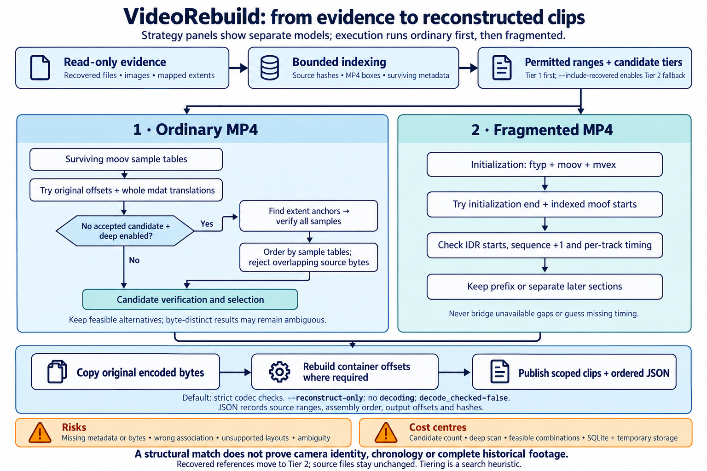
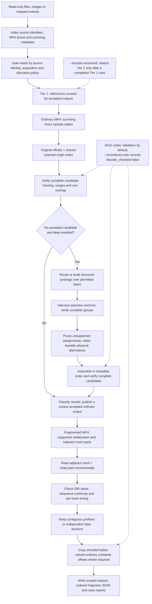

# VideoRebuild

VideoRebuild reconstructs supported AVC/HEVC MP4 video from recovered files, raw disk images and mapped image extents. It matches surviving container metadata to encoded media bytes, rebuilds ordinary MP4 containers, and recovers contiguous fragmented-MP4 prefixes or independently usable later sections.

It runs locally on macOS and Linux with Python 3.13+ and no third-party Python runtime dependencies. Your original inputs remain read-only. Put the case/output directory on healthy storage outside every input tree.

- **Indexed matching:** shared payload-origin and structural indexes avoid repeating candidate scans across recordings and restarts.
- **Resumable cases:** source indexes, search coverage, attempts, publications and reports stay together in one case.
- **CLI and terminal menus:** run commands directly or use a PhotoRec/TestDisk-style interface with filesystem browsing and a read-only case viewer.
- **Assembly evidence:** each output has a JSON manifest recording its ordered source fragments, physical ranges, copied/generated bytes and hashes.
- **Two validation modes:** strict codec validation with FFmpeg/ffprobe 8+, or `--reconstruct-only` for structural reconstruction without decoding.

## Install

Download the wheel from [GitHub Releases](https://github.com/sealad886/VideoRebuild/releases), then install it in a virtual environment:

```bash
python3.13 -m venv .venv
source .venv/bin/activate
python -m pip install /path/to/videorebuild-0.5.0-py3-none-any.whl
videorebuild tui
```

For a command available from any directory, install the downloaded wheel with `pipx` or `uv`:

```bash
pipx install --python python3.13 /path/to/videorebuild-0.5.0-py3-none-any.whl
# Or:
uv tool install --python 3.13 /path/to/videorebuild-0.5.0-py3-none-any.whl
```

To install from a checkout, use `python -m pip install .` in your virtual environment. All interfaces use the same `videorebuild` entry point. Install FFmpeg and ffprobe 8+ separately if you want codec validation; reconstruction-only mode does not require either tool.

## Quick start

Replace the example paths with your recovered-files directory and a case directory on healthy storage:

```bash
videorebuild run --input /recovery/files --case /healthy/case --deep --reconstruct-only
```

`run` indexes the supplied evidence, reconstructs supported recordings and writes reports. Open `CASE/reports/index.html` to review the results. To enable strict codec validation, omit `--reconstruct-only`; `videorebuild doctor` checks the installed validation tools.

You can also separate indexing from reconstruction, resume an indexed case, or refresh its reports:

```bash
videorebuild scan --input /recovery/files --case /healthy/case
videorebuild recover --case /healthy/case --deep --reconstruct-only
videorebuild report --case /healthy/case
```

Re-run the recovery command after interruption. Completed source scans, preliminary matching, deferred deep-search work and reusable search coverage remain in the case. The durable queue resumes unfinished deep jobs without repeating completed preliminary matching, including when `--retry` is present. Completed deep jobs are retained across an interrupted pass; an unfinished deep job may be repeated. After a fully completed pass, `--retry` revisits nonmatched results, reusing completed preliminary work for deferred jobs. Changes to the matching revision or search policy cause affected decisions to be re-evaluated while retaining indexed evidence and published media. Recovery appends to `CASE/run.log`.

## Terminal interface

```bash
videorebuild tui
videorebuild tui --case /healthy/case
videorebuild tui --case /healthy/case --watch
```

The terminal interface uses Python's standard-library `curses` module and requires an interactive terminal. You can choose recovered files, a raw image and a case directory, set recovery options, then review the generated command before starting it. The menu starts with deep search enabled, codec checks disabled and second-tier fallback disabled. Direct CLI commands default to codec validation; supply `--deep --reconstruct-only` to select the same search and validation settings as the menu.

Path fields open a filesystem browser:

| Key | Action |
| --- | --- |
| Up / Down | Select an entry |
| Enter / Right | Open a directory; Enter selects a file when the field accepts files |
| Left / Backspace | Open the parent directory |
| C | Select the current directory |
| N | Name a new case directory inside the current directory |
| G | Jump to a typed path |
| D | Clear an optional field |
| Q / Esc | Cancel or return |

Directories appear before files. On macOS, mounted volumes are under `/Volumes`. Browsing records your selection without creating directories or changing files; the recovery command creates a new case when started.

A running operation uses the same CLI, case lock, progress reporting and interruption handling as a direct command. The **watch** screen reads logs, counts, lock state and available output space. It refreshes automatically, and closing it leaves the recovery process running. An allocation map applies to **recover existing index**; the menu rejects it for scan actions.

Watch progress bars show **work reported for a named phase**, with its actual count and unit. A byte-scan percentage describes bytes examined in that scan; a per-file hashing percentage describes that file. Neither is an overall recovery percentage. Phases without a known positive total show an indeterminate indicator and the observed count. Historical job totals are displayed separately, since jobs can be retried or re-evaluated.

Interrupted, failed and limited phases retain their observed progress. A finished phase does not establish that recovery has completed or that every recording was recovered. Old observations and observations without a confirmed writer are labelled accordingly. Any displayed ETA is an estimate for that byte phase based on its average rate; it is withheld for stale or historical observations. `--no-progress` hides the watch progress bars.

## Input evidence and permitted ranges

You can combine recovered files with a regular raw image and optional PhotoRec/ddrescue evidence:

```bash
videorebuild run \
  --input /recovery/photorec \
  --image /images/disk.img \
  --report /recovery/photorec/report.xml \
  --mapfile /images/disk.map \
  --case /healthy/case --deep --reconstruct-only
```

The PhotoRec report verifies reported headers against image bytes. A ddrescue map qualifies acquisition availability: only `+` ranges are readable. If image and mapfile positions differ, supply `--map-offset DELTA`, where `image position = mapfile position + DELTA`. Neither report establishes filesystem allocation.

For filesystem-guided recovery, supply a DFXML report containing raw byte-run extents through `--extents`. VideoRebuild validates the mappings and reconstructs the mapped logical files. See [source and range architecture](docs/ARCHITECTURE.md) for DFXML, coordinate transforms and acquisition checks.

### Restrict reconstruction to unallocated image space

Image indexing without filesystem extents scans available bytes, including allocated space. To restrict an existing image case to verified unallocated ranges, provide an image-bound allocation policy during recovery:

```bash
videorebuild recover --case /healthy/case --deep --retry --reconstruct-only \
  --allocation-map /healthy/filesystem-unallocated.json
```

The schema-1 policy has `kind: "filesystem-unallocated"` and an `images` array. Each image entry binds its absolute `path`, `size` and indexed `sha256`, with sorted, nonoverlapping `[image_byte_offset, length]` ranges. Every indexed physical image needs an entry. Derive the ranges from filesystem allocation metadata using the correct partition and cluster coordinates. See [allocation scope](docs/ARCHITECTURE.md#filesystem-allocation-scope).

The policy gates reconstruction reads, including metadata, cached candidates and fragment windows, without rebuilding the source index. Recovered-file free-space provenance comes from the tool and selection that produced those files; for PhotoRec, use its **Free / unallocated-space-only** selection. `.DS_Store` is excluded from discovery, indexing, matching and browsing, including `--all-files`.

## How recovery works

The ordinary strategy runs first, including deferred deep search, followed by fragmented recovery. Filenames, file dates and visual similarity do not determine matches or recording order.





### Candidate selection and sequence

| Strategy | How candidates are chosen | How order is established |
| --- | --- | --- |
| Original offsets | For each eligible exact `moov` location, try source origin zero and the nearest preceding permitted `ftyp` origin. | Surviving chunk/sample tables provide track order, timing and relative offsets. |
| Whole payload | Match metadata spans against eligible indexed `mdat` payload origins. Templates share mandatory anchor checks through the payload-origin index. | One translation preserves the original relative chunk layout. |
| Deep search | When whole-payload matching has no accepted result, shared structural postings nominate group locations. Selective required anchors narrow them before full framing checks. | Video chunks and adjacent audio form groups; feasible groups are assembled in metadata order with physical non-overlap. |
| Fragmented MP4 | Supported initialization locations lead to the initialization end and eligible indexed `moof` starts. | Adjacent `moof`/`mdat` pairs must have compatible sequence numbers, track timing and coverage. |

Ordinary recovery copies the original encoded chunks into a new container and rewrites chunk offsets. Fragmented recovery preserves the initialization and original fragment bytes, retaining a contiguous prefix or separately eligible later sections. It does not bridge missing ranges or invent frames, missing timing or wall-clock chronology.

### Recovered-reference tiers

Physical ranges used by accepted outputs move to a lower-priority matching tier. Source files and indexed evidence stay intact. The default searches Tier 1 only; use `--include-recovered` to search Tier 2 after a completed first-tier search finds no match:

```bash
videorebuild recover --case /healthy/case --deep --retry --reconstruct-only --include-recovered
```

Reports record the searched tiers. A first-tier success does not trigger a second-tier uniqueness audit. Within an assembly, logical and physical overlap checks prevent reuse of the same source bytes, including aliases exposed by different mappings.

### Outputs and evidence

`CASE/candidates/` holds accepted reconstruction hypotheses and their JSON evidence, including alternatives that remain ambiguous or search-limited. `CASE/reconstructed/` exposes unique published ordinary results as case-internal hard links to those candidates. Both names refer to the same stored media bytes; adding the published name does not allocate a second media copy. A directory-size tool that counts each name separately can therefore overstate their combined use.

On a filesystem without hard-link support, the validated candidate itself is the published output. Reports and the job's `outputs` field identify its canonical path; publication does not copy the payload into a second directory. Fragmented sections have their own scoped output paths and manifests.

Each output's accompanying JSON contains `ordered_fragments`: assembly order, source locations, physical extents, destination offsets, lengths and hashes. Generated ordinary-container bytes, initialization bytes and copied fragment pairs are identified separately. Fragment entries also record sequence and per-track sample/timing metadata.

With `--reconstruct-only`, outputs retain `decode_checked=false`. Strict mode additionally probes and decodes the result. Byte-distinct ordinary alternatives remain `ambiguous`; explicit search cutoffs produce `search_limited`; an exhausted search with no accepted result is `unresolved`. Fragmented outputs retain their prefix or segment scope.

Structural compatibility and successful decoding establish the checks performed, not historical camera identity or recording completeness. Equal-content or overlapping cross-output associations remain visible evidence for review. The complete contracts are in [ordinary support](docs/SUPPORT.md), [fragmented recovery](docs/FRAGMENTED.md) and [matching design](docs/MATCHING.md).

## Performance and search controls

Payload-origin indexes share structural work across metadata templates. Deep-search postings are persistent and bound to source, mapping and permitted-range identity. Selective anchor joins, compact negative-cache keys, sparse physical-support pruning and bounded fragment-parse reuse reduce repeated work while retaining feasible alternatives.

Both transient search databases and reusable indexes live on the case/output volume:

- `CASE/work/videorebuild-search-*`: temporary search tables, removed when a search closes.
- `CASE/work/structural-index`: durable discovery and payload-origin coverage reused across retries and restarts.

The CLI and TUI use this location directly; no `TMPDIR` setup is required. Auxiliary SQLite sorts use connection-local memory. Keep room for search indexes, candidate files, reports and final media.

Use `--search-workers 1..8` for bounded concurrent discovery across independent sources; the default is 1. Workers use separate readers and bounded queues, while the coordinator writes coverage and publishes results in deterministic order:

```bash
videorebuild recover --case /healthy/case --deep --reconstruct-only --search-workers 2
```

Additional workers can overlap I/O but may contend for the same disk or CPU. Ambiguous assemblies can still require many comparisons; indexed matching does not guarantee linear time for every input. See [matching complexity](docs/MATCHING.md) and [performance evidence](docs/PERFORMANCE.md).

Candidate, padding, hit, assembly, anchor-check and fragmented-start cutoffs are disabled by default. Use `recover --help` for explicit budgets such as `--max-candidates`, `--max-hits`, `--max-assemblies`, `--max-anchor-checks` and `--max-segments`. Reaching a budget records an incomplete search. `--max-groups` sets batch capacity without dropping later jobs; `--limit` bounds the number of new or invalidated metadata records processed. Per-output size and fragmented-section buffer ceilings also apply.

## Reports and monitoring

`CASE/reports/index.html` is the main report. JSON and CSV exports contain typed jobs, results, provenance and validation/search scope; the main machine-readable export is `CASE/reports/results.json`. Per-output sidecars preserve assembly details.

Progress on stderr and in `CASE/run.log` includes phase, work counts, elapsed time and byte throughput. Known totals include an estimated remaining time. Use `--no-progress` to suppress progress feedback while retaining errors and warnings. A completed command or quiet log does not mean every recording was recovered; inspect result statuses and the owning process's exit code.

```bash
videorebuild tui --case /healthy/case --watch
videorebuild report --case /healthy/case
```

## Development

From a checkout, create the project environment and install the editable package:

```bash
python3.13 -m venv .venv
.venv/bin/python -m pip install -e .
.venv/bin/videorebuild --version
.venv/bin/python -m unittest discover -s tests -v
```

Tests generate synthetic media locally and cover encoded-byte preservation, source immutability, ambiguity, malformed inputs, resource bounds and interruption/resume. The full validation suite requires FFmpeg/ffprobe 8+. Package builds use the pinned requirements in `requirements-build.txt`.

See [architecture](docs/ARCHITECTURE.md), [matching design](docs/MATCHING.md), [validation evidence](TEST_REPORT.md), [release procedure](docs/RELEASING.md) and [0.5.0 release notes](docs/RELEASE_NOTES_0.5.0.md). VideoRebuild is distributed under the [MIT license](LICENSE).
