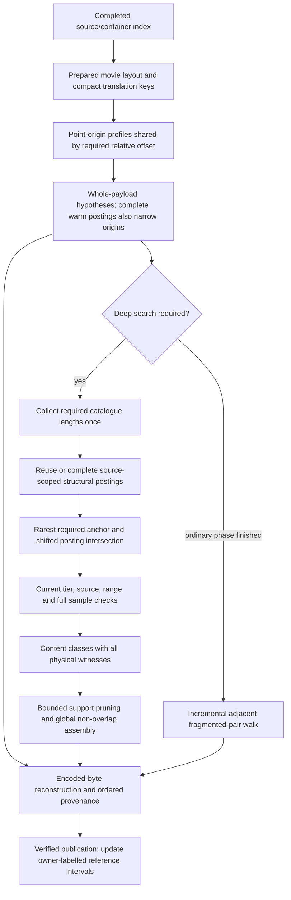

# Indexed matching and reconstruction

VideoRebuild separates discovery of structural facts from current search policy
and from proving a feasible assembly. It preserves the completed container index;
the structural index supplements it. Original input bytes are never changed.

## Structural evidence and coverage

Sample tables provide lengths, relative offsets and codec configuration; they do
not provide the unknown compressed sample bytes. Discovery therefore indexes
structural locations, not invented expected-content hashes. A sample may contain
several NAL units. Cumulative NAL-chain totals, overlapping plausible starts and
unaligned starts must remain discoverable. AVC needs only its actual five-byte
minimum prefix plus payload at a range boundary; HEVC requires its second header
byte only when the unit has enough payload for it.

Index identities include source bindings, logical mappings, allocation and
acquisition scope and parser revision. Coverage receipts include zero-hit
sources. A source is complete only after discovery and identity checks succeed;
partial data cannot settle a negative query. Current owner exemptions and tiers
are checked against queried candidates, allowing one eligible-base index to
serve different owners without importing a narrower tier's negative result.
Explicitly capped searches keep their scoped, incomplete-result semantics.

Complete anchor locations are translated to possible group starts by subtracting
their known relative offsets. The smallest posting list supplies seeds; other
mandatory predicates must agree on the same source/base. Full framing, current
range permissions and hashes still check survivors. This intersection applies
only inside the supported contiguous-group model, not across independently
movable groups. Cold whole-payload search indexes structural facts at known
`mdat` payload origins plus required first-video anchor offsets. Templates with
the same offset share that parsing and match through expected sample lengths.
This needs no new image sweep to find a contiguous match. Original-offset
hypotheses remain; unsupported and explicitly capped searches retain their
original nomination rules and ordering.

If P payload origins and M templates use only D distinct required relative
offsets, cold discovery visits P × D starts rather than M × P template/payload
pairs. Cumulative NAL visits and actual surviving candidates still add work.
When D is small, this is close to linear in P plus metadata size; D can grow with
M on less regular layouts. Scope and completed-profile receipts qualify zero
matches. Read-only query contexts are shared for the reader lifetime, avoiding a
fresh source-catalogue fingerprint or coverage scan for every movie.

## Assembly and physical ownership

Identical observed group content shares computation, while every physical witness
remains available. Bounded sparse conflict/support propagation removes choices
with no required pairwise support. If the derived graph or comparison budget is
exhausted, it returns the unpruned domains. That fallback is a performance choice,
not an incomplete recovery or absence conclusion. The existing assembler still
enforces global non-overlap and can reassign earlier witnesses.

Accepted publications contribute owner-labelled intervals to one shared physical
index. Removing or changing an owner updates its records. Exempting one owner
leaves overlapping claims from other owners blocked. Normalized derived rows are
rebuilt from verified publications on restart; the previous JSON cache is backed
up before its one-time conversion. The exclusive writer identifies its changed
job rather than rescanning all empty catalogue jobs. Accepted publications and
sources still receive fresh integrity checks; a full refresh discovers all job
changes, including during startup.

## Concurrency and resources

`--search-workers 1..8` controls independent source discovery, defaulting to one.
Each worker owns its reader handles. Bounded queues constrain unpublished work;
the coordinator owns SQLite writes, coverage receipts and ordered publication.
Parallelism does not make mutable tier decisions in workers. Parser facts may be
reused only with their exact interpretation context and current read permissions.
No GPU, native-extension or third-party runtime dependency is required.

Fragmented recovery reads adjacent box pairs incrementally under the same byte,
sample, timing and source-range bounds as the in-memory parser. A short malformed
prefix does not require reading an otherwise large trailing window. Later starts
remain eligible for their own checks. Separately recovered sections keep their
existing labels and ordered provenance.

## Complexity and evidence

There is no universal linear bound for unrestricted ambiguous assembly. With
group content-domain sizes d_i, there can be product(d_i) distinct outputs, each
requiring verification/export work. Global physical conflicts also require more
history than the last node of a simple path graph.

The improvements target avoidable work: constant-size translated cache lookup,
reused discovery instead of repeated source passes, selective posting joins,
unique-base checks, sparse support propagation, incremental fragment reads and
expected-logarithmic interval updates. Discovery accounting includes eligible
bytes, NAL-chain visits and emitted postings; a shared byte pass alone does not
prove linear parsing. Common signatures can still produce large candidate sets.

Validation compares encoded bytes and feasible assignments against exhaustive
small synthetic cases, including aliases, allocation gaps, short and multi-NAL
samples, alternative witnesses, incomplete coverage, resumed searches, worker
counts and dense ambiguity. Counters distinguish cache reuse, postings/probes,
group checks, physical conflicts, parser reads and output work. Synthetic
operation counts do not establish throughput or completeness on a live corpus.
